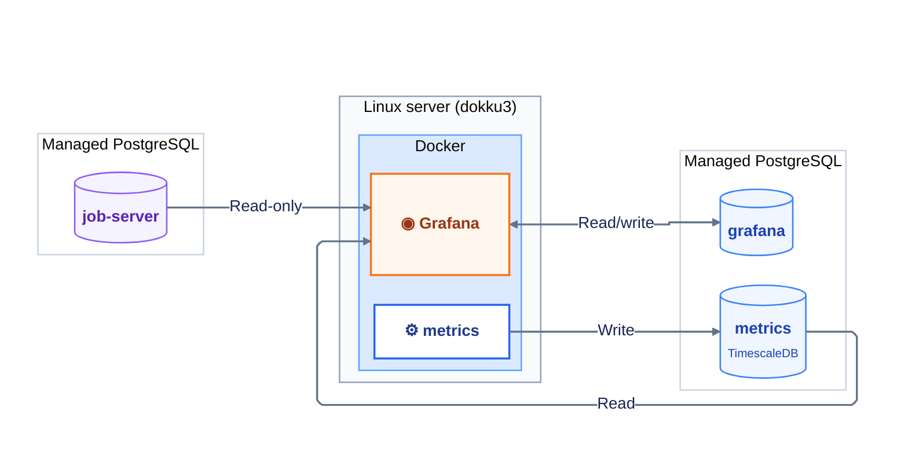
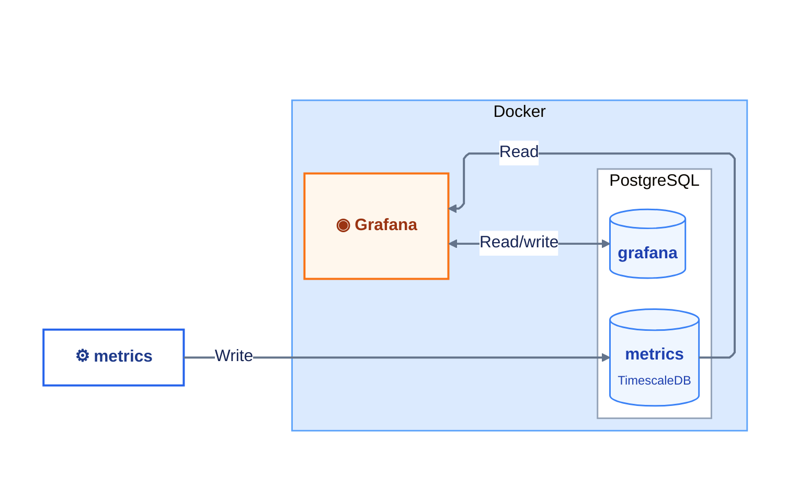

# Notes for developers

## Architecture diagrams

### Production

Everything is hosted on Digital Ocean.



### Local development

Typically, developers run the Grafana and database servers with Docker,
and the Python metrics application outside of Docker.

No job-server database is currently configured.



## System requirements

### just

```sh
# macOS
brew install just

# Linux
# Install from https://github.com/casey/just/releases

# Add completion for your shell. E.g. for bash:
source <(just --completions bash)

# Show all available commands
just #  shortcut for just --list
```


## Local development environment

Set up a local development environment with:
```
just devenv
```

Populate the generated `.env` file with the GitHub PATs described in the [install instructions](INSTALL.md#configure-app).

## Running Grafana

Start the local docker stack with:
```
just grafana
```

This will spin up:

* Grafana
* a PostgreSQL database server with two databases
  * `grafana` for Grafana operation
  * `metrics`, a database using the TimescaleDB extension for data collection

Grafana is available at [http://localhost:3000](http://localhost:3000).
The default credentials are `admin`/`admin`; Grafana asks you to change these when you first log in, but you can skip the change.

### Adding a datasource

1. Go to Connections in the Grafana menu and under that choose "data sources"
   or navigate directly to <http://localhost:3000/connections/datasources>.
1. Click the "Add new data source" button.
1. Choose PostgreSQL.
1. In the form that appears:
   1. Enter the host URL:
      the server address is the service name;
      refer to `docker-compose.yaml` if needed.
   1. Use the username and password from `init.sql` for `grafanareader`.
      (*This mimics how production works,
      with a read-only user for reading metrics data.*)
   1. Enter the database name as `metrics`.
   1. Set TLS/SSL mode to `disable`
      since we do not have this configured for local development.
   1. The PostgreSQL version will probably be automatically set for you.
      If not,
      set it according to the version in the locally running database.
   1. Enable the TimescaleDB toggle option.
1. Click "Save and test" which should work almost immediately.
   If not,
   check over the settings, and that the database is running.

### Adding a dashboard
1. Go to the [production dashboard](https://dashboards.opensafely.org/dashboards) that you want to copy.
2. Go to the "share" icon on the top row and to the "Export" tab.
3. Select "Export for sharing externally" and "Save to file".
4. Go to your local Grafana and [import](https://dashboards.opensafely.org/dashboards) the dashboard (you need to explicitly set the datasource).

## Running metrics tasks

You'll need to have the timescaledb-backed database running in the backend, either by running `just grafana`, or alternatively, to start the database without starting Grafana by doing
```
docker compose up db
```

You can then run the metrics tasks with:
```
just metrics
```

Specify an individual task by passing in the module name
```
just metrics <module_name>
```

e.g `just metrics prs` to run metrics/tasks/prs.py

All tasks are defined in `metrics/tasks` and must have a `main()` function that takes no arguments.

### Speeding up development

You can set a flag to trigger a fast mode which only retrieves and handful of PRs
but allows the main code paths to be tested quickly.

```
DEBUG_FAST=t just metrics prs
```

Alternatively you can turn on caching of GitHub API requests.
This is particularly useful when iterating on metric definitions
without changing the data that we retrieve from the API.

```
DEBUG_CACHE=t just metrics prs
```

NB that the cache has no expiry time
(although it will be bypassed on subsequent runs if `DEBUG_CACHE isn't defined).
You can clear the cache explicitly.

```
just clean-cache
```


## Tests
Run the tests with:
```
just test <args>
```

## Upgrading development databases

If the major database version is upgraded,
the simplest resolution is to delete the Docker database volumes.

Run the following in the same directory as the relevant `docker-compose.yaml`:

```
$ docker compose down
$ docker volume rm metrics_<name of database>
```

and then recollect whatever data via the metrics application that you need.

(The name of the database is now `db`,
but previously there were separate `postgres` and `timescaledb` database volumes.)

Refer to the [Docker Compose documentation](https://docs.docker.com/reference/cli/docker/compose/down/)
if starting afresh is helpful,
and you want to clear more Docker Compose state.

### Migrating data

It is possible to use `pg_dump` or `pg_upgrade` to migrate your data,
but we do not provide convenience `just` recipes or similar for this.

#### Testing upgrades

To test upgrades, it *is* useful to consider using `pg_upgrade`.

You would need to create a Docker image, say as `metrics-pg-upgrade`, that:

1. Is based on the PostgreSQL Docker image of the new target version.
1. Adds the PostgreSQL repository signing key.
1. Installs the current-in-use version of PostgreSQL from the PostgreSQL repository.
1. Possibly adds the TimescaleDB extension for both PostgreSQL versions.

See commit 39e46b3be1b480dd093d1e2a55ed1cd8b8c7fc4e for what has been used previously.

Using that `metrics-pg-upgrade` image when built:

1. Create a new Docker volume: `docker volume create metrics_db_new` or similar.
1. Create a new database (replacing `17` with the appropriate target version)

   ```sh
   docker run --rm \
   --user postgres \
   -v metrics_db_new:/new \
   --entrypoint /usr/lib/postgresql/17/bin/initdb \
   metrics-pg-upgrade \
   -D /new \
   --encoding=UTF8 \
   --locale=en_US.utf8 \
   --username=user
   ```

1. Run `pg_upgrade` (with the `14` and `17` replaced by appropriate current and target versions):

   ```sh
   docker run --rm \
   --user postgres \
   -v metrics_db:/old \
   -v metrics_db_new:/new \
   --entrypoint bash metrics-pg-upgrade \
   -c '
     cd /tmp
     /usr/lib/postgresql/17/bin/pg_upgrade \
       -b /usr/lib/postgresql/14/bin \
       -B /usr/lib/postgresql/17/bin \
       -d /old \
       -D /new \
       -U user
   '
   ```
1. Temporarily switch the `docker-compose.yml` to use the new volume.

## Production

### Database setup

The database server is a managed one.

It contains two databases:

* one for Grafana
* one for metrics data collection, which uses the TimescaleDB extension

#### Database upgrades

##### PostgreSQL

* Major version upgrades do not typically happen automatically
  and require interactive approval.
* A known exception to this rule:
  the version is end-of-life and it may get automatically upgraded.
  * Therefore we aim to schedule testing and deployment of a manual upgrade
    *at latest* a couple of weeks before the end-of-life date.
* Minor version upgrades should happen automatically.
  * (Dependabot is configured to update to the latest non-major version upgrade,
    to keep development in sync with production.)
  * Before deploying any particularly delicate changes to the database,
    you may want to assure that the PostgreSQL version used in development
    does indeed match that in production.

##### TimescaleDB

* The TimescaleDB extension is not typically automatically upgraded,
  and would need `ALTER EXTENSION…` running on the database to upgrade it.
* A known exception to this rule:
  applying a PostgreSQL major version may also upgrade the TimescaleDB extension version.
* If upgrading TimescaleDB,
  it is worth reviewing the [release history](https://github.com/timescale/timescaledb/releases/) for breaking changes.
* New TimescaleDB major or minor version releases typically drop support for a given PostgreSQL version
  around 18 months before the PostgreSQL end-of-life date.

### Deployment

Changes merged to `main` are automatically deployed by GitHub actions.

### Updating metrics

Metrics that are populated by periodic tasks are automatically updated once a day by a Dokku cron job.
This process can also be triggered out-of-schedule.

```
you@your-laptop:~$ ssh dokku3.ebmdatalab.net
you@dokku3:~$ dokku cron:list metrics
ID        Schedule  Command
<the-id>  @daily    python -m metrics.tasks
you@dokku3:~$ dokku cron:run metrics <the-id>
```
